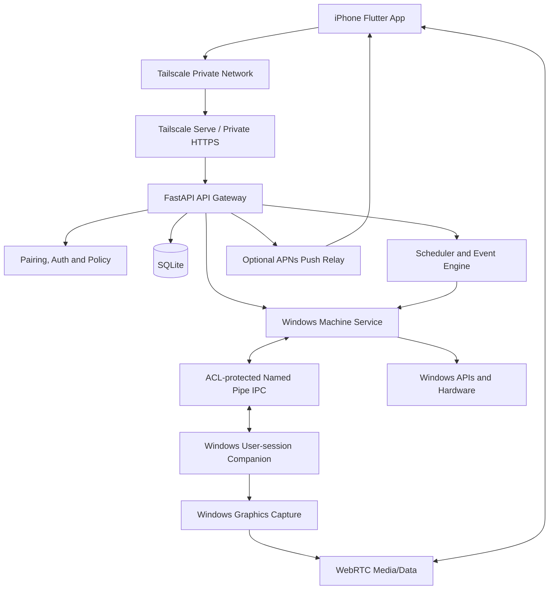

# ControlHub — AI Coding Agent Implementation Specification

**Version:** 1.0  
**Status:** Approved master specification  
**Controller:** iPhone (Flutter)  
**Managed device:** Personally owned Windows 10/11 laptop  
**Remote access:** Private Tailscale network  
**Delivery model:** Modular monorepo; incremental, test-driven milestones

## 1. Product summary

ControlHub is a private remote laptop management system. An iPhone app lets the owner manage a Windows laptop remotely: power operations, live screen viewing and interactive desktop control, system monitoring, file transfer, process/application management, notifications, automation, network utilities, remote utilities and device security.

The product is for the owner's own devices. It must be visible, consent-based and secure. No covert monitoring, hidden recording, keylogging, credential capture, security bypass, or unrestricted remote shell.

### Goals
- Control the laptop over a private network from the iPhone.
- Provide reliable power and status operations.
- Show live and historical hardware/system metrics.
- Stream the desktop using WebRTC.
- Support explicitly approved file and process operations.
- Deliver useful alerts and durable scheduled automations.
- Start automatically and recover after ordinary failures.
- Keep modules separate so the architecture can expand.

### Non-goals
- Public multi-tenant SaaS.
- Access to devices that have not been paired and authorized.
- Publicly exposed laptop API, default port forwarding or Tailscale Funnel.
- Arbitrary PowerShell, shell, executable path or code execution from the phone.
- Bypassing Windows login, UAC, secure desktop or endpoint security.
- Guaranteeing WoL on unsupported hardware/network configurations.
- Hidden screen capture or recording.

## 2. Approved feature scope

All features below are approved for the product roadmap. They must be implemented in milestones, not in one large unreviewed code-generation pass.

### 2.1 Power management
- Shutdown, restart, sleep, hibernate.
- Lock the current Windows session.
- Turn display off/on where hardware and Windows APIs support it.
- Cancel pending shutdown/restart.
- Schedule one-time and recurring power actions.
- Wake-on-LAN.
- Power-state and power-event history.

Destructive operations require explicit confirmation. Shutdown/restart default to a 30-second grace period and must support cancellation where Windows allows it. The UI must distinguish “request accepted” from “device reached requested state.” Sleep/hibernate can make the agent unreachable. WoL only reports packet sent unless a separate wake confirmation is obtained. Remote WoL may require an always-on relay on the laptop's LAN.

### 2.2 Remote desktop
- Live screen streaming.
- Separate view-only and interactive modes.
- Multiple monitor selection.
- Screenshots.
- Resolution, frame-rate and bitrate quality settings.
- Pause, resume and stop session.

View-only is the default. Interactive mode requires separate authorization and a visible Windows sharing/control indicator. The local user must always be able to stop sharing. Do not capture secure desktop, UAC secure prompts, password fields or Windows sign-in screen. Suspend capture while locked or when secure desktop is active. Do not record by default; any future recording feature requires explicit opt-in, visible recording indicator, retention controls and local stop controls.

### 2.3 System monitoring
- CPU usage/model/frequency where available.
- RAM total, used, available and percentage.
- GPU usage/memory/temperature where supported by driver/vendor APIs.
- Disk total/used/free and percentage.
- Battery level, charging state and estimated time where available.
- Temperature telemetry where exposed by supported hardware/drivers.
- Network throughput and adapter state.
- Uptime and boot time.
- Process-level resource monitoring.
- Historical graphs and metric retention.

Unsupported sensors must be returned as `null`/unavailable, never fabricated.

### 2.4 File management
- Browse approved folders.
- Upload from iPhone and download to iPhone.
- Create folders, rename, move within approved roots, delete.
- Search, metadata and preview for supported image/PDF types.
- Transfer progress, retry, cancel and history.

File access must be restricted to explicitly configured roots. Canonicalize every path and reject traversal, reparse-point/symlink/junction escapes, device paths and alternate data streams. Enforce file-size and storage limits. Confirm delete and overwrite. Use chunked streaming; do not load entire large files into memory. Never expose arbitrary absolute paths or the whole drive by default.

### 2.5 Application and process management
- List applications/processes.
- Show PID, name, CPU, memory and start time.
- Search/filter.
- Launch approved applications from a server-side allowlist.
- Terminate approved user processes.
- Show resource consumption.

Protect Windows/system/security processes. Do not accept arbitrary executable paths. Termination requires confirmation and must validate PID plus process creation time to mitigate PID reuse.

### 2.6 Notifications
- Online/offline and startup/shutdown/sleep/resume events where detectable.
- Battery, temperature and CPU threshold alerts.
- Transfer completed/failed.
- Scheduled action reminders/results.
- Screen sharing started/stopped.
- Push notifications and in-app history.

Thresholds, categories and quiet hours are configurable. Push is best-effort; durable events remain on the laptop. Push payloads must not contain tokens, file names, screen contents, clipboard contents or sensitive process details. APNs credentials belong only in an optional push relay, never in the app.

### 2.7 Automation and scheduling
- One-time and recurring scheduled tasks.
- Trigger-condition-action rules.
- Battery, temperature, idle-time and connectivity conditions.
- Recurring maintenance.
- Schedule shutdown, restart, sleep and approved app launch.
- Enable/disable/edit/delete, dry run, execution history and failure reasons.

Use a persistent SQLite-backed scheduler. Store timestamps in UTC and retain time-zone identifiers for recurrence. Handle daylight-saving transitions. Only allowlisted action types may execute. High-impact actions require explicit rule activation and policy confirmation. Use idempotency keys and execution locks to prevent duplicates after restart. Show missed-run behavior when the laptop was asleep/offline.

### 2.8 Network utilities
- Wi-Fi SSID where Windows permissions/API allow.
- Network adapters, connection state and local IPs.
- Upload/download throughput.
- Tailscale health.
- Safe connection diagnostics and internet reachability.
- WoL configuration and relay status.

Never expose Wi-Fi passwords, Tailscale auth keys or private keys. No intrusive arbitrary network scanning.

### 2.9 Remote utilities
- Volume/mute.
- Brightness where supported.
- Clipboard synchronization (opt-in, off by default, explicit user action).
- Approved command presets with typed/validated parameters.
- Approved application shortcuts.

Never automatically collect clipboard contents. No unrestricted command execution.

### 2.10 Security and device management
- QR pairing with short-lived one-time challenge.
- Per-device credentials and revocation.
- Face ID/device passcode confirmation for sensitive actions.
- Encrypted transport.
- Token/session rotation and expiry.
- Audit logs and active session management.
- Emergency disable remote access.
- Visible local screen-sharing indicator and local stop control.
- Rate limiting and least privilege.

## 3. Architecture

### 3.1 Logical architecture



### 3.2 Components

**Flutter iOS app**
- Flutter/Dart.
- Suggested packages: `flutter_secure_storage`, `dio` or `http`, `web_socket_channel`, `flutter_webrtc`, `local_auth`, `file_picker`, `path_provider`, `go_router`, and Riverpod or Bloc.
- Verify current package compatibility before pinning.
- Store device credentials in iOS Keychain.
- No Tailscale auth keys, APNs private keys or universal secrets in the app.

**FastAPI API host**
- REST API, WebSocket events/signalling, authentication, authorization, policy, idempotency, rate limiting and audit.
- Bind only to `127.0.0.1`.
- Expose privately using Tailscale Serve or equivalent.
- No arbitrary shell or raw filesystem endpoint.

**Windows machine service**
- Prefer C#/.NET Windows Service for production machine-level lifecycle and privileged operations.
- Runs under a dedicated low-privilege identity where possible.
- Handles machine-level operations, durable scheduler supervision, health and IPC.
- Do not run as LocalSystem unless a specific documented requirement exists.
- Do not interact with logged-in desktop from Session 0.

**Windows user-session companion**
- Starts at user sign-in.
- Runs in interactive user session.
- Handles screen capture, remote input after approval, lock workstation, user notifications, clipboard and user-session audio/display controls.
- Shows tray icon and active sharing indicator.
- Has a local stop-sharing/disable-remote-control action.
- Communicates with service over ACL-protected named pipes, never network-exposed IPC.

**Screen capture and WebRTC**
- Windows Graphics Capture API.
- H.264 hardware encoding where available, software fallback if needed.
- WebRTC for encrypted media and optional data channels.
- Authenticated signalling through API WebSocket.
- Do not proxy video frames through FastAPI REST.
- Prefer peer-to-peer media over tailnet where practical; if TURN is required, deploy privately and document bandwidth/cost.
- Stop/suspend capture on lock, secure desktop, local stop, device revocation or session expiry.

**Database**
- SQLite with WAL, foreign keys, busy timeout and migrations.
- Transactional scheduler and audit writes.
- Backups and retention cleanup.
- Secrets outside ordinary tables; use DPAPI/Credential Manager or OS-protected storage.

### 3.3 Connectivity

1. Install Tailscale on Windows and iPhone.
2. Sign both devices into the owner's tailnet.
3. Bind API to loopback only.
4. Configure Tailscale Serve for private HTTPS ingress.
5. Restrict tailnet ACLs to trusted devices.
6. Still require application-level auth for every protected API.

Never use Funnel, public port forwarding or bind FastAPI to `0.0.0.0` by default. Tailscale membership is not sufficient authorization by itself.

### 3.4 Lifecycle and availability

- Machine service may start at Windows boot.
- User-session companion starts after user sign-in.
- Desktop functions are unavailable until companion connects.
- Laptop agent is unreachable while laptop sleeps, hibernates or is shut down.
- App must show online, offline, asleep/unknown and last-seen distinctly where evidence allows.
- WoL is a separate packet/relay action; a powered-off laptop cannot receive API requests.
- Remote WoL may require an always-on relay (router, NAS, Raspberry Pi or trusted device) on the laptop's LAN.

## 4. Technology stack

| Layer | Technology |
|---|---|
| Mobile | Flutter / Dart, iOS first |
| API | Python / FastAPI |
| Windows service | C# / .NET Windows Service |
| User companion | C# / .NET desktop/tray app |
| Local IPC | ACL-protected Windows named pipes |
| Screen capture | Windows Graphics Capture |
| Video | H.264 + WebRTC |
| Signalling | FastAPI WebSocket |
| Network | Tailscale + private Serve |
| Database | SQLite |
| Metrics | psutil + Windows/vendor APIs |
| Scheduler | Durable SQLite-backed scheduler |
| Push | Optional APNs relay |
| iOS secrets | Keychain via secure storage |
| Windows secrets | DPAPI/Credential Manager |
| Tests | pytest, Flutter tests, Windows integration/E2E |

The coding agent must check current official docs and package versions during implementation; do not blindly copy stale versions.

## 5. API contracts

All endpoints use `/api/v1`. JSON UTF-8. Timestamps ISO-8601 UTC. Mutating operations should accept an `Idempotency-Key`.

### 5.1 Authentication

Protected requests:

```http
Authorization: Bearer <per-device-access-token>
Content-Type: application/json
X-Request-ID: <uuid>
Idempotency-Key: <uuid>
```

Use per-device credentials, short-lived access tokens and refresh/rotation. Revoke lost devices. Store token in iOS Keychain and Windows secrets using OS-protected storage. Never log tokens.

Common success:

```json
{
  "request_id": "uuid",
  "status": "accepted",
  "data": {},
  "message": "Request accepted",
  "timestamp": "2026-01-01T12:00:00Z"
}
```

Common error:

```json
{
  "request_id": "uuid",
  "status": "error",
  "error": {
    "code": "CONFIRMATION_REQUIRED",
    "message": "Explicit confirmation is required"
  },
  "timestamp": "2026-01-01T12:00:00Z"
}
```

Do not return stack traces, secrets or internal exception text.

### 5.2 Device

| Method | Endpoint | Purpose |
|---|---|---|
| GET | `/api/v1/health` | Minimal liveness |
| GET | `/api/v1/device/status` | OS, host, agent/companion state, uptime |
| GET | `/api/v1/device/capabilities` | Supported capabilities |
| GET | `/api/v1/device/connection` | Tailnet/connectivity state |

### 5.3 Power

| Method | Endpoint | Purpose |
|---|---|---|
| POST | `/api/v1/power/shutdown` | Shutdown |
| POST | `/api/v1/power/restart` | Restart |
| POST | `/api/v1/power/sleep` | Sleep |
| POST | `/api/v1/power/hibernate` | Hibernate |
| POST | `/api/v1/power/lock` | Lock session |
| POST | `/api/v1/power/display/off` | Display off |
| POST | `/api/v1/power/display/on` | Display on |
| POST | `/api/v1/power/cancel` | Cancel pending action |
| GET | `/api/v1/power/pending` | Pending operation |
| POST | `/api/v1/power/wol` | Request WoL via relay |

Example request:

```json
{"confirm": true, "delay_seconds": 30, "reason": "User initiated"}
```

Response includes `operation_id`, action, scheduled time and cancellable flag. Bound delay (e.g. 0–3600 seconds). Default shutdown/restart delay is 30 seconds. Do not report successful state transition merely because command submission succeeded.

### 5.4 Monitoring and processes

| Method | Endpoint | Purpose |
|---|---|---|
| GET | `/api/v1/metrics/current` | Current metrics |
| GET | `/api/v1/metrics/history` | Historical samples |
| GET | `/api/v1/metrics/capabilities` | Sensor availability |
| GET | `/api/v1/processes` | Process list |
| GET | `/api/v1/processes/{pid}` | Process detail |
| POST | `/api/v1/processes/{pid}/terminate` | Terminate permitted process |

History query: `metric`, `from`, `to`, `interval`, `limit`. Use `null` for unsupported GPU/temperature sensors. Termination requires confirmation, PID and process creation time.

### 5.5 Files

| Method | Endpoint | Purpose |
|---|---|---|
| GET | `/api/v1/files` | List within approved root |
| GET | `/api/v1/files/metadata` | Metadata |
| GET | `/api/v1/files/download/{file_id}` | Download |
| POST | `/api/v1/files/upload-sessions` | Create upload |
| PUT | `/api/v1/files/upload-sessions/{id}/chunks/{n}` | Upload chunk |
| POST | `/api/v1/files/upload-sessions/{id}/complete` | Finalize |
| DELETE | `/api/v1/files/upload-sessions/{id}` | Cancel |
| POST | `/api/v1/files/folders` | Create folder |
| PATCH | `/api/v1/files/items/{id}` | Rename/move within root |
| DELETE | `/api/v1/files/items/{id}` | Delete after confirmation |
| GET | `/api/v1/files/search` | Search approved roots |

Use opaque IDs or root-relative paths. Never accept arbitrary absolute paths. Validate canonical path on every operation.

### 5.6 Applications/processes

| Method | Endpoint | Purpose |
|---|---|---|
| GET | `/api/v1/apps` | Approved application catalogue |
| POST | `/api/v1/apps/{app_id}/launch` | Launch approved app |
| GET | `/api/v1/processes` | Process list |
| POST | `/api/v1/processes/{pid}/terminate` | Terminate allowed process |

No client-supplied executable path. Protect critical processes.

### 5.7 Events and notifications

| Method | Endpoint | Purpose |
|---|---|---|
| GET | `/api/v1/events` | Paginated history |
| POST | `/api/v1/events/{id}/read` | Mark read |
| GET | `/api/v1/notifications/preferences` | Read preferences |
| POST | `/api/v1/notifications/preferences` | Update preferences |
| POST | `/api/v1/notifications/test` | Test notification |

Event fields: ID, timestamp, category, severity, safe title/summary and read state.

### 5.8 Automation

| Method | Endpoint | Purpose |
|---|---|---|
| GET | `/api/v1/automations` | List |
| POST | `/api/v1/automations` | Create |
| GET | `/api/v1/automations/{id}` | Detail |
| PATCH | `/api/v1/automations/{id}` | Update |
| DELETE | `/api/v1/automations/{id}` | Delete |
| POST | `/api/v1/automations/{id}/enable` | Enable |
| POST | `/api/v1/automations/{id}/disable` | Disable |
| POST | `/api/v1/automations/{id}/dry-run` | Preview |
| GET | `/api/v1/automations/{id}/runs` | Run history |

Rule example:

```json
{
  "name": "Low battery alert",
  "enabled": true,
  "trigger": {"type": "metric_threshold", "metric": "battery.percent", "operator": "lt", "value": 20},
  "conditions": [{"type": "power_state", "operator": "eq", "value": "awake"}],
  "action": {"type": "notification", "template": "low_battery"},
  "cooldown_seconds": 1800
}
```

Strict schema and action registry only. No executable strings or arbitrary code in rules.

### 5.9 Network and remote utilities

| Method | Endpoint | Purpose |
|---|---|---|
| GET | `/api/v1/network/adapters` | Adapter state |
| GET | `/api/v1/network/connection` | Connectivity |
| POST | `/api/v1/network/diagnostics` | Safe diagnostics |
| GET | `/api/v1/network/tailscale` | Tailnet health |
| GET/PUT | `/api/v1/network/wol/config` | WoL config |
| GET/PUT | `/api/v1/remote/audio` | Volume/mute |
| GET/PUT | `/api/v1/remote/display` | Display/brightness |
| POST | `/api/v1/remote/clipboard/pull` | Explicit clipboard read |
| POST | `/api/v1/remote/clipboard/push` | Explicit clipboard write |
| GET | `/api/v1/commands/presets` | Approved presets |
| POST | `/api/v1/commands/presets/{id}/run` | Run validated preset |

Clipboard off by default. No Wi-Fi passwords, Tailscale private keys or auth keys in API responses.

### 5.10 Pairing/security

| Method | Endpoint | Purpose |
|---|---|---|
| POST | `/api/v1/pairing/start` | Short-lived pairing challenge |
| POST | `/api/v1/pairing/complete` | Complete pairing |
| GET | `/api/v1/devices/paired` | List controllers |
| DELETE | `/api/v1/devices/paired/{id}` | Revoke controller |
| POST | `/api/v1/auth/refresh` | Refresh credential |
| POST | `/api/v1/auth/revoke` | Revoke current session |
| GET | `/api/v1/security/sessions` | Active sessions |
| DELETE | `/api/v1/security/sessions/{id}` | Revoke session |
| GET | `/api/v1/audit` | Audit events |
| POST | `/api/v1/security/remote-access/disable` | Emergency disable |

Pairing uses a short-lived one-time challenge in a QR code. Require local Windows confirmation. QR must not contain a long-lived secret.

### 5.11 WebSocket and WebRTC signalling

- `/api/v1/ws/events` — authenticated event stream.
- `/api/v1/ws/remote-session/{session_id}/signal` — authenticated signalling.

Event types: `device.status`, `metrics.sample`, `power.operation.updated`, `transfer.progress`, `automation.run`, `notification.created`, `remote.session.started`, `remote.session.stopped`.

Signalling messages include session ID, message type (`offer`, `answer`, `ice_candidate`, `renegotiate`, `close`), payload and request/sequence ID. Validate session ownership and authorization on every message.

## 6. Remote desktop requirements

### View-only
1. iPhone requests session and selects display/quality.
2. Windows companion presents local approval or follows an explicit owner-configured trusted-device policy.
3. Visible sharing indicator appears.
4. WebRTC stream starts.
5. iPhone can pause/stop.
6. Local user can stop immediately from tray.

### Interactive
- Separate request and authorization from view-only.
- Local approval required for first-time enablement and configurable per session.
- Persistent visible “Remote control active” indicator.
- Mouse/keyboard over separately authorized WebRTC data channel or secure control channel.
- Validate session state and input bounds.
- Local user can revoke input instantly.

### Quality presets
- Low bandwidth: target 720p, 10–15 FPS.
- Balanced: target 1080p, 20–30 FPS.
- High: source resolution where practical, target 30 FPS.
Actual quality adapts to hardware and network; never promise fixed performance.

### Privacy
No secure desktop, UAC secure prompts, password fields or Windows sign-in capture. No hidden capture or recording. Audit session metadata, not screen content. Stop on lock, secure desktop, revocation, timeout or local stop.

## 7. Windows service and startup design

Windows services run in Session 0 and cannot reliably interact with the logged-in desktop. Use two components:

**Machine service**
- Starts at boot.
- Restricted identity and least privilege.
- Machine-level operations, scheduler supervision, health, IPC.
- No direct desktop interaction.
- Avoid LocalSystem unless documented need.

**User-session companion**
- Starts at sign-in.
- Interactive screen capture, lock, input, clipboard, user notifications and supported audio/display controls.
- Tray icon, visible sharing indicator and local stop.
- Connects to service via ACL-protected named pipes.
- Never exposes IPC to network.

Provide documented install/uninstall and update scripts. Use code signing for release binaries where feasible. Do not use stealth persistence. If initial implementation uses Task Scheduler at logon, document that pre-login features are unavailable.

## 8. Database design

Use SQLite with WAL, foreign keys, migrations, backups and retention cleanup.

| Table | Important columns |
|---|---|
| `paired_devices` | id, display_name, platform, credential_hash, created_at, last_seen_at, revoked_at, status |
| `sessions` | id, device_id, created_at, expires_at, revoked_at, last_activity_at |
| `audit_events` | id, request_id, actor_device_id, action, target, result, redacted_details_json, created_at |
| `metric_samples` | id, sampled_at, cpu_percent, memory_percent/bytes, disk_percent, battery_percent, gpu_percent, temperature_c, network_rx/tx |
| `power_operations` | id, action, requested_by, requested_at, scheduled_for, state, result_message |
| `file_roots` | id, display_name, canonical_path, enabled, max_file_size_bytes |
| `transfers` | id, direction, relative_path, total_bytes, transferred_bytes, state, timestamps |
| `automation_rules` | id, name, enabled, trigger_json, conditions_json, action_json, timezone, cooldown, timestamps |
| `automation_runs` | id, rule_id, idempotency_key, started_at, finished_at, state, redacted_result_json |
| `notifications` | id, category, severity, title, safe_message, created_at, read_at |
| `remote_sessions` | id, device_id, mode, display_id, state, started_at, ended_at, local_approval |

Never store raw access tokens, APNs keys, Tailscale private keys, clipboard history or screen recordings by default. Use DPAPI/OS secure storage for secrets. Add indexes for timestamps, device IDs, rules and transfer state. Define metric/event retention.

Suggested initial retention (configurable): high-resolution metrics 7 days; hourly downsampled metrics 90 days; notifications 90 days; audit 180 days; transfer metadata 30 days; remote-session metadata 90 days.

## 9. iPhone UX and navigation

Bottom navigation:
1. **Home** — laptop status, health, quick power actions.
2. **Remote** — screen viewer and interactive control.
3. **Files** — approved-root browser and transfer queue.
4. **Activity** — alerts, events, automation runs and audit summaries.
5. **Settings** — pairing, security, network and preferences.

UX requirements:
- Dark mode first, support iOS light mode and safe areas.
- Clear online/offline/asleep/unknown states.
- Show stale metrics, loading and errors distinctly.
- Never fabricate metrics or capability.
- Confirm destructive actions.
- Show pending/cancellable power operations.
- Keep stop-sharing accessible during remote session.
- Accessible labels, dynamic type and contrast.
- Remote viewer supports landscape, fullscreen, fit/zoom, display selection, quality, virtual keyboard, touch-to-mouse and scroll.
- File UI has breadcrumbs, search, previews, progress, speed, remaining time, retry and cancel.

## 10. Security requirements (release blockers)

- Tailscale private network and HTTPS; no public ingress by default.
- API binds loopback only.
- App-level auth for all protected requests.
- Per-device credentials, rotation, expiry and revocation.
- Face ID/passcode confirmation for sensitive operations.
- Scopes/capabilities such as `power:write`, `screen:view`, `screen:control`, `files:read`, `files:write`.
- Rate limiting, idempotency and replay protection.
- Audit all sensitive actions.
- Never log tokens or secrets.
- Allowlisted file roots, canonical path checks, file quotas and atomic writes.
- Protected-process denylist and PID creation-time validation.
- No generic shell/PowerShell/exec endpoint.
- Clipboard off by default and explicit.
- Visible screen-sharing indicator and local stop.
- Stop screen capture on lock/secure desktop.
- Push payloads contain no secrets/private content.
- Emergency disable and device revocation.
- No hidden monitoring, keylogging or silent recording.

Security tests must include missing/invalid/revoked credentials, expiry, replay/duplicate actions, rate limits, path traversal, reparse-point escape, protected process termination, remote control without approval, lock/secure desktop capture stop, and secret redaction in logs/push.

## 11. Observability, reliability and performance

Health components: API, machine service, companion, database, scheduler, Tailscale, WebRTC and optional push relay.

- Recover API/service after ordinary failure.
- Scheduler survives restart and does not duplicate actions.
- Incomplete transfers become recoverable or expired.
- Sessions close on revocation.
- Show last successful contact and stale state.
- Reduce background sampling when app is not viewing dashboard.
- Metrics refresh default 3–5 seconds while dashboard visible.
- File transfer memory use must not scale with file size.
- Target typical metadata API latency under 500 ms on healthy local/tailnet conditions.
- Screen quality adapts; targets are not guarantees.

## 12. Repository structure

```text
controlhub/
├── apps/mobile/
│   ├── lib/app/
│   ├── lib/core/
│   ├── lib/data/
│   ├── lib/domain/
│   ├── lib/features/
│   │   ├── dashboard/ remote_desktop/ files/ monitoring/
│   │   ├── power/ automation/ notifications/ processes/
│   │   ├── network/ settings/
│   └── test/
├── windows/
│   ├── service/
│   ├── companion/
│   ├── ipc-contracts/
│   ├── capture/
│   └── installer/
├── backend/
│   ├── controlhub_api/
│   │   ├── api/ auth/ domain/ services/ repositories/
│   │   ├── scheduler/ events/ security/
│   ├── migrations/
│   └── tests/
├── infrastructure/
│   ├── tailscale/ scripts/ packaging/
├── docs/
│   ├── architecture.md api-contracts.md threat-model.md
│   ├── operations.md decisions/
└── README.md
```

Keep OS-specific code behind adapters. Use explicit contracts between mobile, API, service and companion.

## 13. Development milestones and acceptance criteria

### M0 — Foundation
Deliver monorepo, CI, formatters/linters, architecture decision records, API schema, local setup, threat model.
Acceptance:
- Clean checkout builds.
- CI runs tests/linters.
- No secrets committed.
- Setup and architecture documented.

### M1 — Windows agent and core power
Deliver API, auth foundation, device status/capabilities, shutdown/restart/sleep/hibernate/lock, cancellation, operation tracking, audit, user-session companion and automatic startup.
Acceptance:
- API binds loopback only.
- Unauthenticated calls rejected.
- Power actions audited.
- Grace period/cancel work.
- Lock runs in interactive session.
- Sleep/hibernate limitations are clear.
- No arbitrary command endpoint.
- Restart recovery tested.

### M2 — Tailscale and pairing
Deliver private ingress, QR pairing, per-device credentials, revocation, iPhone connection UI and health.
Acceptance:
- iPhone connects over cellular via tailnet.
- No public port forwarding/Funnel.
- Revoked phone denied.
- Credentials in Keychain.
- API-level auth remains enforced.

### M3 — Monitoring
Deliver CPU/RAM/disk/battery/network, GPU/temp where supported, process list, historical storage/graphs and capability reporting.
Acceptance:
- Metrics reasonably match Windows telemetry.
- Unsupported sensors unavailable, not fabricated.
- History filters work.
- Sampling is configurable and resource-conscious.

### M4 — Remote desktop
Deliver Windows Graphics Capture, WebRTC signalling, H.264, view-only, visible local indicator/stop, multiple displays, quality presets, screenshots and separately authorized interactive mode.
Acceptance:
- iPhone receives stream over private network.
- Local indicator is visible.
- Local stop works immediately.
- View-only sends no input.
- Interactive requires separate authorization.
- Lock/secure desktop stops capture.
- No hidden recording.
- Revocation closes session.

### M5 — File management
Deliver allowlisted roots, browse/search/metadata, chunked transfer, progress, create/rename/delete and previews.
Acceptance:
- Traversal and reparse-point escape tests pass.
- Outside-root access denied.
- Large files stream.
- Delete/overwrite confirmed.
- Cancel/retry and integrity validation work.

### M6 — Apps and processes
Deliver process metrics, app allowlist, launch and safe termination.
Acceptance:
- Protected processes cannot be killed.
- PID reuse mitigated.
- No arbitrary executable paths.
- Actions audited.

### M7 — Notifications
Deliver event engine, preferences, thresholds, APNs relay (optional) and in-app history.
Acceptance:
- Configured events generate.
- Quiet hours/categories work.
- Push contains no sensitive content.
- Missed events available after reconnect.

### M8 — Automation
Deliver persistent scheduler, rule builder, schema, dry run, recurrence/time zones and run history.
Acceptance:
- Rules survive restart.
- Duplicate execution prevented.
- DST tested.
- High-impact rules require activation/confirmation.
- Offline/missed runs reported.
- Only allowlisted actions execute.

### M9 — Network and remote utilities
Deliver adapter/Tailscale status, safe diagnostics, WoL/relay, volume/brightness, opt-in clipboard and approved command presets.
Acceptance:
- No credentials exposed.
- WoL distinguishes packet sent from device awakened.
- Clipboard off by default.
- Presets are typed/validated.
- Unsupported controls clearly unavailable.

### M10 — Production hardening and release
Deliver signed installer, secure updates, backup/recovery, threat-model review, E2E/performance testing and user docs.
Acceptance:
- Install/uninstall tested.
- Revocation tested.
- Security checklist complete.
- Crash/restart recovery tested.
- Logs redact secrets.
- Remote desktop privacy verified.
- P0/P1 defects resolved.
- Release and rollback docs exist.

## 14. Testing strategy

**Unit:** auth, policy, power state machine, scheduler recurrence, idempotency, path canonicalization, root authorization, metric normalization, notification thresholds, process protection.

**Integration:** FastAPI/SQLite, service/companion IPC, capture lifecycle, WebRTC signalling, Tailscale, chunked transfers, APNs relay, scheduler recovery.

**End-to-end:**
- Pair iPhone.
- Connect on Wi-Fi and cellular.
- Fetch dashboard.
- Lock, sleep/resume.
- Schedule/cancel shutdown.
- Start view-only stream.
- Approve interactive session.
- Stop locally.
- Upload/download file.
- Revoke phone and verify denial.
- Trigger notification.
- Run safe scheduled action.

Test Windows 11 on AC/battery, Wi-Fi/Ethernet if available, single/multiple monitors, sleep/resume, hibernate/resume and supported WoL hardware.

## 15. Deployment

**Development:** local loopback API, companion in user session, Tailscale Serve, Flutter debug build on registered iPhone.

**Personal production:** signed Windows installer, separate service and companion, OS-protected secrets, Tailscale ACLs, signed iOS app, QR pairing, optional APNs relay, backup and retention.

**Updates:** sign binaries/packages, verify signatures, support rollback, do not update during active remote session without safe handling, keep migrations backward-compatible, never execute unsigned downloaded scripts.

## 16. Risks and mitigations

| Risk | Mitigation |
|---|---|
| Laptop asleep/offline | Last-seen state; WoL relay if supported |
| Session 0 restrictions | Separate service and user companion |
| Capture unavailable | Capability detection and clear state |
| NAT/network restrictions | Tailscale; private TURN only if needed |
| Battery/network use | Adaptive sampling and stream quality |
| Lost iPhone | Revoke per-device credential |
| Token theft | Keychain, rotation, expiry, audit |
| Path traversal | Allowlisted roots and canonicalization |
| Accidental shutdown | Confirmation, delay, cancellation |
| Duplicate automation | Idempotency and durable scheduler |
| Push failure | Durable local event history |
| Unsupported sensors | Explicit unavailable state |

## 17. Instructions to the AI coding agent

You are implementing ControlHub from this specification. Follow these rules:

1. Read the entire document before coding.
2. Inspect the repository and preserve working code unless a change is justified.
3. Start with M0 and M1 only. Do not implement the entire roadmap in one pass.
4. Produce an implementation plan and architecture decision records for major choices.
5. Verify current official docs and package compatibility for Flutter, iOS, Windows APIs, .NET, FastAPI, WebRTC and Tailscale.
6. Prefer documented OS APIs over shell commands.
7. Keep API on loopback; use private Tailscale ingress.
8. Never add arbitrary shell/PowerShell execution.
9. Never implement covert capture, hidden recording, keylogging, credential capture or security bypass.
10. Use a Windows machine service plus user-session companion for desktop interaction. Never interact with desktop directly from Session 0.
11. Treat all client requests as untrusted, even over Tailscale.
12. Implement per-device credentials, revocation, audit and least privilege.
13. Restrict files to allowlisted roots and validate canonical paths.
14. Unsupported hardware capabilities must be unavailable, not fabricated.
15. Add automated tests with every feature. Do not leave critical security controls as TODOs.
16. Do not claim features are implemented until built and tested on target devices.
17. Do not fabricate test results, performance, hardware support or WoL success.
18. Keep secrets out of source, logs, crash reports, push payloads and docs.
19. Update README/API docs as implementation changes.
20. Stop after each milestone and report results before proceeding.

### Required report after every milestone
- Delivered behavior.
- Architecture decisions.
- Files created/modified.
- Build/run commands.
- Automated test results.
- Manual Windows/iPhone test steps.
- Known limitations.
- Security review checklist.
- Recommendation for next milestone.

### Definition of done
A milestone is complete only when code builds, tests pass, relevant manual tests are documented/performed where hardware is required, security requirements are met, errors and unsupported capabilities are handled, docs are updated, and no secrets are committed.

## 18. Final product definition

ControlHub is a private, owner-operated Windows laptop control system with an iPhone-first Flutter app. It includes power management, remote desktop, monitoring, file management, process/application management, notifications, automation, network utilities, remote utilities and security.

Priorities:
1. Security and owner consent.
2. Reliable Windows lifecycle integration.
3. Accurate online/asleep/offline/unknown states.
4. Visible remote screen sharing.
5. Safe file and process operations.
6. Durable automation.
7. Modular implementation and testability.

**Implementation instruction: Begin with Milestone 0 and Milestone 1 only. Build the secure foundation first.**
